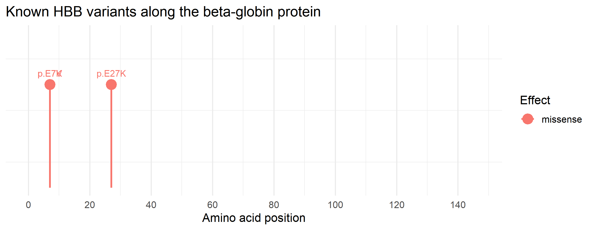

# HBB Variant Effect Analysis

A Python and R pipeline that compares wild-type and mutant human beta-globin (HBB) for three clinically important variants: HbS, HbC and HbE.

## Question

How do known point mutations in the human beta-globin gene (*HBB*) change the protein sequence, and how different are the resulting amino acid substitutions?

## Method

1. Fetched the *HBB* mRNA reference (NM_000518.5) from NCBI using Biopython (`Bio.Entrez`).
2. Extracted the coding sequence (CDS) and checked that the reference codon at each variant position matched the expected wild-type codon (GAG) before applying the change. [TODO: keep this line only if your script does this check]
3. Applied the known variants (HbS, HbC, HbE) to the CDS to create three mutant sequences.
4. Translated the wild-type and mutant CDS into proteins.
5. Aligned each mutant protein to the wild-type protein with pairwise global alignment, BLOSUM62 scoring, gap open/extend = [TODO: your values], using `Bio.Align.PairwiseAligner`. [TODO: edit to match your script]
6. Classified each variant by effect type and by the chemical nature of the substitution, and plotted variant positions along the protein in R (ggplot2).

## Results

| Variant | HGVS (current) | Legacy name | Codon change | Substitution | BLOSUM62 score | Effect |
|---|---|---|---|---|---|---|
| HbS (sickle) | c.20A>T, p.Glu7Val | Glu6Val | GAG → GTG | acidic → hydrophobic | -2 | missense |
| HbC | c.19G>A, p.Glu7Lys | Glu6Lys | GAG → AAG | acidic → basic | +1 | missense |
| HbE | c.79G>A, p.Glu27Lys | Glu26Lys | GAG → AAG | acidic → basic | +1 | missense |

Each variant changes one residue of the 147-residue beta-globin protein, so every mutant is 99.32% identical to wild type (146/147 residues). Sequence identity therefore cannot separate these variants. The substitution type and BLOSUM62 score are more informative.



## Interpretation

- **HbS (Glu7Val):** a negatively charged residue is replaced by a hydrophobic valine at the protein surface. This is the change that allows deoxygenated haemoglobin S to polymerise, causing red cell sickling. It has the lowest BLOSUM62 score of the three, which fits it being the least conservative substitution.
- **HbC (Glu7Lys):** the same position as HbS, but the charge is reversed from negative to positive.
- **HbE (Glu27Lys):** a charge reversal at a different position.

## Limitations

- This analysis works at the sequence level only. It does not model protein structure, stability or function.
- HbE (c.79G>A) also activates a cryptic splice site in exon 1, which reduces the amount of normal beta-globin mRNA and produces a mild thalassaemia phenotype. A pipeline that translates the CDS sees only the missense change and misses this splicing effect.
- Only three variants were analysed. HBB has hundreds of known variants.

## Notes on numbering

- Variants use HGVS c. numbering, where the A of the start codon ATG is c.1.
- The translated protein has 147 residues including the initiator methionine. Legacy haemoglobin numbering starts after that methionine is removed, so legacy positions are one lower than current HGVS positions. This is why the sickle mutation appears as Glu6Val in older papers and p.Glu7Val in current notation.
- Keep this in mind when mapping variants onto 3D structures, as many PDB haemoglobin entries use the legacy numbering.

## Repository structure

```
hbb-variant-analysis/
├── variant_analysis.py      # fetch, mutate, translate, align, classify
├── plot_variants.R          # ggplot2 variant map
├── requirements.txt
├── results/
│   └── hbb_variant_map.png
└── README.md
```

## Requirements

- Python 3.9+ with Biopython
- R with the `ggplot2` package
- Internet access (the script downloads the sequence from NCBI)

## How to run

1. Install the Python dependency:
   ```
   pip install -r requirements.txt
   ```
2. Open `variant_analysis.py` and set `Entrez.email` to your own email address (NCBI requires this).
3. Run the analysis:
   ```
   python variant_analysis.py
   ```
   This writes [TODO: name of your output file, e.g. results/variant_results.csv].
4. In RStudio, install ggplot2 once with `install.packages("ggplot2")`, then run `plot_variants.R`. It reads [TODO: input file name] and saves the figure to `results/hbb_variant_map.png`.

## Tools

Python 3, Biopython, R, ggplot2

## License

MIT
